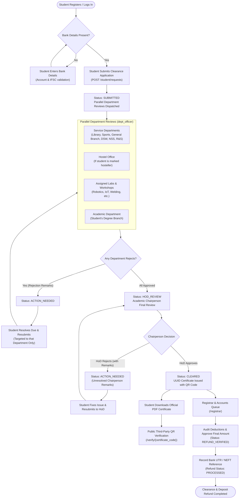

# SVSU No-Dues Clearance & Security Deposit Refund System

An institutional digital clearance and security deposit refund management platform developed for **Shri Vishwakarma Skill University (SVSU)**. This system modernizes the traditional university clearance process by replacing physical paper-based clearance slips with parallel departmental reviews, cryptographic certificate issuance, and auditable registrar refund disbursement.

---

## 1. System Overview

Graduating and departing students require clearance from multiple university bodies before graduating, receiving diplomas, and claiming refund of their caution/security deposit. Traditionally, this entails students walking paper forms between disparate university offices, departments, hostels, and workshops.

This application provides an automated end-to-end digital lifecycle:
- **Parallel Clearance Reviews**: Student clearance requests dispatch simultaneously to all applicable service branches, academic departments, hostels, and assigned workshops.
- **Granular Resubmissions**: If a department identifies an outstanding obligation (e.g., library fine, unreturned sports kit, lab equipment damage), the student resolves only that specific due and resubmits to that department without re-routing approvals already granted.
- **Academic Chairperson (HoD) Final Clearance**: Following 100% department approval, the student's department Head conducts final verification and issues an official university digital certificate.
- **Tamper-Evident Verification**: Certificates carry an immutable UUID verification code and QR code verifiable by employers and third parties without authentication.
- **Registrar Deposit Reconciliation**: The Finance & Registrar team reviews initial roster security deposits, audits deductions, and records bank payment references (UTR/NEFT) upon disbursement.

---

## 2. End-to-End Workflow Diagram



---

## 3. Role Matrix & Capabilities

The system defines 5 distinct role profiles with strict role-based access control (RBAC):

| Role | Key Permissions & Portal Views | Primary Tasks |
|---|---|---|
| `student` | Portal: `/student`<br/>Routes: `/student/bank-details`, `/student/requests` | Verify institutional identity with OTP, register bank account details, apply for clearance, track real-time department timeline, resubmit rejected dues, download official clearance PDF. |
| `dept_officer` | Portal: `/officer`<br/>Routes: `/department/queue`, `/department/approvals/{id}` | Access department-specific inbox, review student context & attachments, grant approvals, or reject with mandatory explanatory remarks. |
| `hod` | Portal: `/hod`, `/hod/requests/:id`<br/>Routes: `/hod/queue`, `/hod/requests/{id}/approve` | Review student clearance dossiers once 100% of parallel departments have approved; review audit trail and remarks; approve to issue certificate or reject with remarks. |
| `registrar_accounts` | Portal: `/registrar`<br/>Routes: `/registrar/queue`, `/registrar/requests/{id}/verify-refund`, `/registrar/requests/{id}/mark-processed` | Audit initial security deposit against departmental deductions; calculate net refund amount; record bank payment reference (UTR) upon NEFT/RTGS disbursement. |
| `admin` | Portal: `/admin`<br/>Routes: `/admin/roster`, `/admin/users`, `/admin/departments` | Manage student roster, ingest batch student CSV data, assign student labs/hostel flags, provision staff & faculty accounts with one-time credentials, reset passwords, toggle user active status. |

---

## 4. Technology Stack

### Frontend
- **Framework**: React 19 (Plain JavaScript JSX)
- **Bundler & Tooling**: Vite with ESM code-splitting
- **UI Components**: shadcn/ui primitives built on Radix UI
- **Styling**: Tailwind CSS with "Minimalist White" institutional theme tokens
- **Data & State Management**: TanStack Query v5 (React Query), React Hook Form
- **Tables**: TanStack Table v8 (`@tanstack/react-table`) with sortable columns and pagination
- **Motion & Typography**: GSAP + Lenis (dynamically loaded on public landing route only), Syne headings & Inter body fonts
- **Feedback**: Sonner toasts

### Backend
- **Framework**: FastAPI (Python 3.12+)
- **ORM & Database**: SQLAlchemy 2.0 (synchronous engine with `SessionLocal` sessionmaker), PostgreSQL (`postgres:16-alpine`)
- **Migrations**: Alembic with sequential revisions
- **Package Manager**: uv
- **Authentication**: OAuth2 Password Flow with Bearer JWT tokens (`pyjwt`, `passlib` with `bcrypt`)
- **Document Generation**: ReportLab PDF generator with embedded QR code generation
- **Testing**: Pytest with `httpx` test client and isolated test database (`nodues_test`)

---

## 5. Architecture Overview

```
┌─────────────────────────────────────────────────────────────┐
│                       Client Browser                        │
│   React 19 SPA (Vite) + Radix Primitives + TanStack Query    │
└──────────────┬──────────────────────────────▲───────────────┘
               │ HTTPS / JSON                 │ Responses
               ▼                              │
┌─────────────────────────────────────────────────────────────┐
│                    FastAPI Backend (Port 8000)              │
│  ├── Security & Auth (JWT Bearer Token, Bcrypt Passwords)    │
│  ├── Role-Based Authorization Dependencies (RBAC)           │
│  ├── Business Logic & State Transition Machine               │
│  └── PDF Generation Service (ReportLab + QR Code)           │
└──────────────┬──────────────────────────────▲───────────────┘
               │ Synchronous SQL Queries      │
               ▼                              │
┌─────────────────────────────────────────────────────────────┐
│         PostgreSQL Database (postgres:16-alpine)            │
│  ├── Student Roster & Academic Mapping                      │
│  ├── Users, Roles & Department Association                  │
│  ├── Clearance Requests & Parallel Approval Rows            │
│  └── Audit Trail & Historical Clearance Events              │
└─────────────────────────────────────────────────────────────┘
```

---

## 6. How to Run Everything

### Prerequisites
- [Docker](https://www.docker.com/) & Docker Compose
- [Python 3.12+](https://www.python.org/) and [`uv`](https://github.com/astral-sh/uv)
- [Node.js v18+](https://nodejs.org/) and `npm`

---

### Step 1: Start PostgreSQL Database Container
Run from the `backend/` directory:
```bash
cd backend
docker compose up -d
```
*PostgreSQL will be running on `localhost:5432` with credentials defined in `backend/.env`.*

---

### Step 2: Apply Alembic Migrations
Run from the `backend/` directory:
```bash
uv run alembic upgrade head
```

---

### Step 3: Seed Synthetic University Data
Populate university departments, academic branches, laboratories, staff accounts, and student test roster:
```bash
uv run python -m scripts.seed_synthetic
```

---

### Step 4: Start the FastAPI Backend Server
Run from the `backend/` directory:
```bash
uv run fastapi dev src/backend/app/main.py --host 0.0.0.0 --port 8000
```
- Interactive Swagger UI: [http://localhost:8000/docs](http://localhost:8000/docs)
- ReDoc Documentation: [http://localhost:8000/redoc](http://localhost:8000/redoc)
- OpenAPI JSON Contract: [http://localhost:8000/openapi.json](http://localhost:8000/openapi.json)

---

### Step 5: Start the React Frontend Application
In a separate terminal window, navigate to the `frontend/` directory:
```bash
cd frontend
npm install
npm run dev
```
Open your browser at [http://localhost:5173](http://localhost:5173).

---

### Verification & Testing Commands
```bash
# Run backend pytest test suite (executes on nodues_test database)
uv run --directory backend pytest

# Run frontend ESLint check
npm --prefix frontend run lint

# Run frontend production build & chunk inspection
npm --prefix frontend run build
```

---

## 7. Demo Accounts by Role

All seeded demo accounts are provisioned via `backend/scripts/seed_synthetic.py` using synthetic profiles. Passwords are never published in public documentation; they are derived from the `SEED_DEFAULT_PASSWORD` environment variable in `backend/.env`.

| Role | Demo Email Address | User Full Name / Assigned Scope |
|---|---|---|
| **System Administrator** | `admin@example.edu` | System Administrator (Demo) |
| **Registrar & Accounts** | `registrar.accounts@example.edu` | Accounts Officer (Demo) / R&S Branch & Finance |
| **Chairperson (HoD) CS/IT** | `hod.csit@example.edu` | Chairperson, Skill Department of CS/IT (Demo) |
| **Department Officer (Library)** | `library.officer@example.edu` | Library Officer (Demo) / Central Library |
| **Department Officer (Hostel)** | `hostel.officer@example.edu` | Hostel (Boys/Girls) Officer (Demo) |
| **Department Officer (Sports)** | `sports.officer@example.edu` | Sports Officer (Demo) / Sports & Gymnasium |
| **Department Officer (CS/IT)** | `officer.csit@example.edu` | Skill Department of CS/IT Officer (Demo) |
| **Department Officer (Accounts)** | `accounts.officer@example.edu` | Account Section Officer (Demo) |
| **Student 1 (Hosteller)** | `arjun.mehta@example.edu` | Arjun Mehta (Reg: `DEMO2026001`, B.Tech CE, Assigned: Lab-2, Lab-5) |
| **Student 2 (Hosteller)** | `priya.sharma@example.edu` | Priya Sharma (Reg: `DEMO2026002`, MCA, Assigned: Lab-3) |
| **Student 3 (Day Scholar)** | `sneha.patel@example.edu` | Sneha Patel (Reg: `DEMO2026004`, B.Voc Solar Technology) |
| **Unregistered Student (Sign-Up Demo)** | `aman.gupta@example.edu` | Aman Gupta (Reg: `DEMO2026006`, Roster only — for OTP sign-up flow) |

> [!NOTE]
> **Institutional Email Format Note**: Real university email formats (students: `<registration_number>@svsu.ac.in`, staff: `<name>@svsu.ac.in`) are accepted and normalized by the system during production registration and login, but they are not part of the demo data. All seeded demo accounts exist strictly on the `@example.edu` domain.

---

## 8. University Structure vs Synthetic Data Attribution

- **Institutional Structure**: Faculty names, academic departments (e.g., *Skill Faculty of Engineering & Technology*, *Skill Department of CS/IT*), service branches (*Central Library*, *Hostel Office*, *Dean Student Welfare*, *General Branch*), and degree programmes are modeled accurately after the real public academic framework of **Shri Vishwakarma Skill University (SVSU)** in Haryana, India.
- **Privacy & Synthetic Data Guarantee**: All personal individual identities—including student names, roll/registration numbers, staff identities, email addresses, contact phone numbers, and bank account numbers—are **100% synthetic**. No real personal data is stored or processed.

---

## 9. Known Limitations & Future Work

1. **Email Notifications & Real-Time Delivery**: There are no external email/SMS notifications implemented yet; one-time passwords (OTPs) print to the terminal console during local development unless an external SMTP provider is configured.
2. **Clearance Request Lifecycle**: There is currently no mechanism for a student to withdraw or cancel a clearance request once submitted.
3. **Staff Email Immutability**: There is no staff-email change endpoint; institutional staff and administrator emails are fixed once provisioned.
4. **Direct Payment Gateway Integration**: Current refund disbursement records a manual bank reference (UTR/NEFT) entered by the Registrar. Production deployments would integrate with university bank APIs or payment webhooks (e.g., RazorpayX / Cashfree Payouts) for automated single-click disbursements.
5. **Multi-Factor Authentication (MFA)**: Adding time-based one-time password (TOTP / Google Authenticator) support for administrative, HoD, and Registrar roles.
6. **Digital Signature Certificates (DSC)**: Integrating e-Sign / USB cryptographic token validation (eMudhra) to attach X.509 digital signatures to the generated clearance PDFs alongside the UUID verification hash.
7. **Bulk PDF Archive Export**: Providing department officers and university auditors with one-click end-of-semester batch ZIP exports of all cleared student certificates.

---

## 10. Screenshots

*Visual walkthrough of the SVSU No-Dues Clearance Portal:*

### Public Portal & Certificate Verification
| Landing Page & Process Timeline | Public QR Code Certificate Verification |
|:---:|:---:|
|  |  |

### Student Experience
| Student Dashboard & Clearance Timeline | Bank Details Registration Modal |
|:---:|:---:|
|  |  |

### Institutional Review Queues
| Department Officer Queue & Approval Dialog | Academic Chairperson (HoD) Audit & Decision |
|:---:|:---:|
|  |  |

### Administration & Financial Settlement
| Registrar & Accounts Refund Disbursement | Administrator Master Roster & Batch CSV Upload |
|:---:|:---:|
|  |  |
