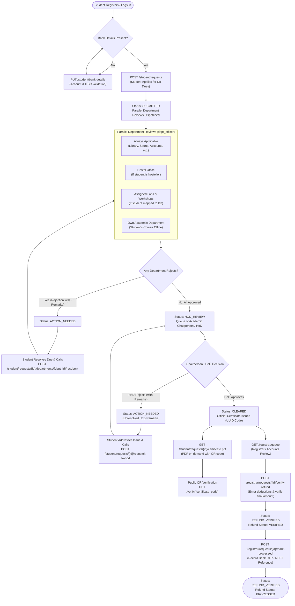

# SVSU No-Dues Clearance System — Frontend Developer API Guide

Welcome! This guide is the complete contract for frontend engineers building the React application. You do not need direct database access; everything is managed through the FastAPI REST API and documented interactively via Swagger UI.

---

## 1. Quick Start: Running the Backend

Run these commands inside the `backend/` folder:

```bash
# 1. Start the PostgreSQL container (if not already running)
docker compose up -d

# 2. Apply database migrations
uv run alembic upgrade head

# 3. Seed demo university departments, courses, officers, and test students
uv run python -m scripts.seed_synthetic

# 4. Start the FastAPI development server with hot reload
uv run fastapi dev src/backend/app/main.py --host 0.0.0.0 --port 8000
```

### API & Docs URLs
- **Interactive Swagger UI**: [http://localhost:8000/docs](http://localhost:8000/docs)
- **OpenAPI JSON Schema**: [http://localhost:8000/openapi.json](http://localhost:8000/openapi.json)
- **Interactive ReDoc**: [http://localhost:8000/redoc](http://localhost:8000/redoc)

---

## 2. Complete End-to-End Clearance Workflow



---

## 3. Status Glossary

### Clearance Request Statuses (`status`)
| Status | Meaning | What the Frontend Should Show |
|---|---|---|
| `SUBMITTED` | Application received and reviews are actively pending across departments. | "Clearance in Progress" badge; show progress bar and department checklist. |
| `ACTION_NEEDED` | One or more departments or the HoD rejected the request. | Alert banner with rejection remarks; show "Resubmit" button next to rejected department(s). |
| `HOD_REVIEW` | All department clearances approved; awaiting final Chairperson / HoD clearance. | "Awaiting Final HoD Approval" banner. |
| `CLEARED` | HoD gave final clearance; official certificate generated. | Success banner; show "Download Certificate (PDF)" button. |
| `REFUND_VERIFIED`| Accounts & Registration verified or processed security deposit refund. | "Refund Verified / Disbursed" confirmation badge with payment reference. |

### Refund Statuses (`refund_status`)
- `PENDING_VERIFICATION`: Initial state when clearance request is created. Initial deposit amount locked from roster.
- `VERIFIED`: Registrar/Accounts verified deductions (if any) and approved final refund amount.
- `PROCESSED`: Bank payment reference recorded; refund disbursed to student bank account.

---

## 4. API Endpoints Reference

### Authentication (`/auth`)
| Method | Path | Allowed Roles | Description |
| :--- | :--- | :--- | :--- |
| `POST` | `/auth/signup/request-otp` | Public | Validates student against roster and dispatches 6-digit OTP. |
| `POST` | `/auth/signup/verify` | Public | Verifies OTP (max 5 attempts), sets password, and provisions account. |
| `POST` | `/auth/login` | Public | OAuth2 password flow (`username` = email) returning Bearer JWT token. |
| `GET` | `/auth/me` | Authenticated | Returns current authenticated user, full name, role, and roster info. |

### Student Clearance & Profile (`/student`)
| Method | Path | Allowed Roles | Description |
| :--- | :--- | :--- | :--- |
| `GET` | `/student/bank-details` | `student` | Returns masked account number (`********1234`), IFSC, holder name, bank address. |
| `PUT` | `/student/bank-details` | `student` | Updates bank details (validates 9-18 digit account, standard IFSC). Never echoes full number. |
| `POST` | `/student/requests` | `student` | Initiates clearance application (fails if bank details are missing). |
| `GET` | `/student/requests/current` | `student` | Returns active clearance request, department checklist, and HoD remarks. |
| `POST` | `/student/requests/{id}/departments/{dept_id}/resubmit` | `student` | Resubmits a rejected department review back to `PENDING`. |
| `POST` | `/student/requests/{id}/resubmit-to-hod` | `student` | Resubmits an HoD-rejected request back to `HOD_REVIEW`. |
| `GET` | `/student/requests/{id}/certificate.pdf` | `student` | Downloads official clearance certificate with QR code (only for owner when CLEARED). |

### Department Officers (`/department`)
| Method | Path | Allowed Roles | Description |
| :--- | :--- | :--- | :--- |
| `GET` | `/department/queue` | `dept_officer` | Returns pending approval tasks for officer's assigned department. Supports `status` and `search` (by student name or registration number). |
| `POST` | `/department/approvals/{id}/decision` | `dept_officer` | Submits approval or rejection (with required remarks) for an approval line. |

### Departments Directory (`/departments`)
| Method | Path | Allowed Roles | Description |
| :--- | :--- | :--- | :--- |
| `GET` | `/departments` | Authenticated | Lists all active academic and service university departments (`id`, `name`, `kind`, `applicability`). |

### Chairperson / HoD (`/hod`)
| Method | Path | Allowed Roles | Description |
| :--- | :--- | :--- | :--- |
| `GET` | `/hod/queue` | `hod` | Returns clearance requests waiting in `HOD_REVIEW` for the Chairperson's department. |
| `GET` | `/hod/requests/{id}` | `hod` | Retrieves full student clearance dossier, department sign-offs with `decided_by_name`, and `certificate_code` if cleared. |
| `POST` | `/hod/requests/{id}/decision` | `hod` | Approves clearance (issuing certificate number) or rejects it with remarks. |

### Public Verification (`/verify`)
| Method | Path | Allowed Roles | Description |
| :--- | :--- | :--- | :--- |
| `GET` | `/verify/{certificate_code}` | Public | Public certificate check. Returns `{valid, issued_at, masked_registration_number, programme, department}`. No privacy leaks. |

### Registrar / Accounts (`/registrar`)
| Method | Path | Allowed Roles | Description |
| :--- | :--- | :--- | :--- |
| `GET` | `/registrar/queue` | `registrar_accounts` | Paginated queue of requests. Supports `status=CLEARED` (default) and `status=REFUND_VERIFIED`, returning `deductions` and `final_amount`. |
| `POST` | `/registrar/requests/{id}/verify-refund` | `registrar_accounts` | Enters deductions (`0 <= deductions <= deposit`), sets `final_amount`, status to `REFUND_VERIFIED`. |
| `POST` | `/registrar/requests/{id}/mark-processed` | `registrar_accounts` | Records bank transaction reference (`payment_reference`), sets refund status to `PROCESSED`. |

### University Administration (`/admin`)
| Method | Path | Allowed Roles | Description |
| :--- | :--- | :--- | :--- |
| `POST` | `/admin/roster/upload` | `admin` | Uploads student roster CSV; returns row-by-row created/updated/rejected report. Synchronizes updated emails to linked user accounts. |
| `GET` | `/admin/roster` | `admin` | Paginated roster search by registration number, name, or email. |
| `PATCH` | `/admin/roster/{id}` | `admin` | Updates email, hosteller status, deposit amount, address, or mobile. Automatically syncs email to student user account in same transaction. |
| `PUT` | `/admin/roster/{id}/assigned-departments` | `admin` | Replaces assigned laboratories / workshops for a student. |
| `GET` | `/admin/users` | `admin` | Paginated user accounts directory with `role` and `search` query parameters. Includes `department_name` and `full_name`. Never returns password hashes. |
| `POST` | `/admin/users` | `admin` | Provisions staff user (`dept_officer`, `hod`, `registrar_accounts`). Returns one-time temporary password. |
| `POST` | `/admin/users/{id}/reset-password` | `admin` | Generates a new one-time temporary password for a user. |
| `PATCH` | `/admin/users/{id}/active` | `admin` | Activates/deactivates user (admin cannot deactivate themselves). |

---

## 5. Seeded Demo Accounts

All seeded demo accounts are generated via `backend/scripts/seed_synthetic.py`. Default passwords are never published in documentation; they are derived from the `SEED_DEFAULT_PASSWORD` environment variable in `backend/.env`.

| Role | Email Address | Display Name / Department |
|---|---|---|
| **Admin** | `admin@example.edu` | System Administrator (Demo) |
| **Registrar / Accounts** | `registrar.accounts@example.edu` | Accounts Officer (Demo) / R&S Branch |
| **Chairperson (HoD) CS/IT** | `hod.csit@example.edu` | Chairperson Skill Department of CS/IT (Demo) |
| **Library Officer** | `library.officer@example.edu` | Library Officer (Demo) / Central Library |
| **Hostel Officer** | `hostel.officer@example.edu` | Hostel (Boys/Girls) Officer (Demo) |
| **Sports Officer** | `sports.officer@example.edu` | Sports Officer (Demo) / Sports Section |
| **Academic Officer (CS/IT)** | `officer.csit@example.edu` | Skill Department of CS/IT Officer (Demo) |
| **Accounts Officer** | `accounts.officer@example.edu` | Account Section Officer (Demo) |
| **Student 1 (Hosteller)** | `arjun.mehta@example.edu` | Arjun Mehta (DEMO2026001, B.Tech CE, Assigned: Lab-2, Lab-5) |
| **Student 2 (Hosteller)** | `priya.sharma@example.edu` | Priya Sharma (DEMO2026002, MCA, Assigned: Lab-3) |
| **Student 3 (Day Scholar)** | `sneha.patel@example.edu` | Sneha Patel (DEMO2026004, B.Voc Solar Tech) |
| **Unregistered Student (Sign-Up Demo)** | `aman.gupta@example.edu` | Aman Gupta (DEMO2026006, test OTP sign-up flow) |

> **Institutional Email Format Note**: Real university email formats (students: `<registration_number>@svsu.ac.in`, staff: `<name>@svsu.ac.in`) are accepted and normalized by the system during production registration and login, but they are not part of the demo dataset. All seeded demo accounts exist strictly on the `@example.edu` domain.

---

## 6. End-to-End Demo Checklist for Teammates

Follow this checklist to demonstrate the full application lifecycle:

- [ ] **Step 1: Check Bank Details**
  - Log in as `arjun.mehta@example.edu`.
  - Call `GET /student/bank-details` -> verify masked account `********0001`.
  - Update with `PUT /student/bank-details` -> verify masked response.
- [ ] **Step 2: Submit Clearance Application**
  - Call `POST /student/requests` -> status `SUBMITTED`, parallel reviews dispatched.
- [ ] **Step 3: Department Officers Approve / Reject**
  - Log in as `library.officer@example.edu` -> `GET /department/queue`.
  - Call `POST /department/approvals/{id}/decision` with `{"decision": "APPROVED"}`.
  - Approve all other departments.
- [ ] **Step 4: Chairperson Final Review**
  - Log in as `hod.csit@example.edu` -> `GET /hod/queue`.
  - Review request `GET /hod/requests/{id}`.
  - Call `POST /hod/requests/{id}/decision` with `{"decision": "APPROVED"}` -> status moves to `CLEARED`.
- [ ] **Step 5: Certificate & Public QR Verification**
  - Switch back to student -> call `GET /student/requests/{id}/certificate.pdf` -> inspect binary PDF with QR code.
  - Scan or copy certificate UUID -> call `GET /verify/{uuid}` without auth -> confirms valid issue timestamp and academic department with zero privacy leaks.
- [ ] **Step 6: Registrar Refund Reconciliation**
  - Log in as `registrar.accounts@example.edu` -> call `GET /registrar/queue`.
  - Verify refund: `POST /registrar/requests/{id}/verify-refund` with `{"deductions": 200, "remarks": "Minor lab breakage"}` -> status becomes `REFUND_VERIFIED`.
  - Mark disbursed: `POST /registrar/requests/{id}/mark-processed` with `{"payment_reference": "NEFT202610260099"}` -> refund status becomes `PROCESSED`.
