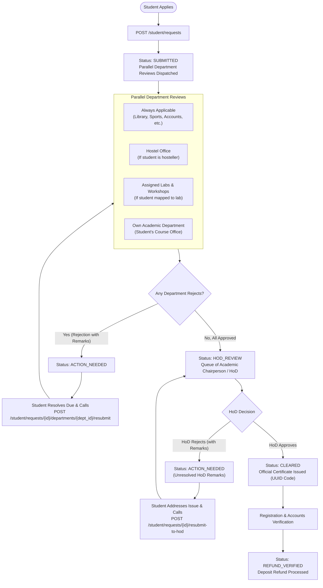

# SVSU No-Dues Clearance System — Frontend Developer API Guide

Welcome! This guide is the complete contract for frontend engineers building the React application. You do not need database access; everything is managed through the FastAPI REST API and documented interactively via Swagger UI.

---

## 1. Quick Start: Running the Backend

Run these commands inside the `backend/` folder:

```bash
# 1. Start the PostgreSQL container (if not already running)
docker compose up -d

# 2. Apply database migrations
uv run alembic upgrade head

# 3. Seed demo university departments, courses, officers, and test students
uv run python -m scripts.seed_synthetic

# 4. Start the FastAPI development server with hot reload
uv run fastapi dev src/backend/app/main.py --host 0.0.0.0 --port 8000
```

### API & Docs URLs
- **Interactive Swagger UI**: [http://localhost:8000/docs](http://localhost:8000/docs)
- **OpenAPI JSON Schema**: [http://localhost:8000/openapi.json](http://localhost:8000/openapi.json)
- **Interactive ReDoc**: [http://localhost:8000/redoc](http://localhost:8000/redoc)

---

## 2. Clearance Workflow & Architecture



---

## 3. Status Definitions

### Clearance Request Statuses (`status`)
| Status | Meaning | What the Frontend Should Show |
|---|---|---|
| `SUBMITTED` | Application received and reviews are actively pending across departments. | "Clearance in Progress" badge; show progress bar and department breakdown. |
| `ACTION_NEEDED` | One or more departments or the HoD rejected the request. | Alert banner with rejection remarks; show "Resubmit" button next to rejected department(s). |
| `HOD_REVIEW` | All department clearances approved; awaiting final Chairperson / HoD clearance. | "Awaiting Final HoD Approval" banner. |
| `CLEARED` | HoD gave final clearance; official certificate has been generated. | Success banner; show "Download / View Certificate" button. |
| `REFUND_VERIFIED`| Accounts & Registration verified security deposit refund. | "Refund Processed" confirmation with deposit amount. |

### Department Approval Statuses (`approval_status`)
- `PENDING`: Department review is pending.
- `APPROVED`: Department officer confirmed no dues.
- `REJECTED`: Department officer flagged dues/issues (remarks are mandatory).

---

## 4. How to Authenticate & Test in Swagger

1. Open [http://localhost:8000/docs](http://localhost:8000/docs).
2. Click the green **Authorize** button at the top right.
3. In the modal:
   - **Username**: Enter the demo user's email (see table below).
   - **Password**: Enter the value configured in `SEED_DEFAULT_PASSWORD` in your `backend/.env`.
   - Click **Authorize**, then **Close**.
4. Swagger will now automatically attach the `Authorization: Bearer <token>` header to all requests.

---

## 5. Demo Accounts By Role

> **Password**: For all seeded accounts below, the password is the value set in `SEED_DEFAULT_PASSWORD` in `backend/.env`. (Never hardcode or commit this password).

| Role | Email Address | Department / Affiliation | Notes |
|---|---|---|---|
| `admin` | `admin@example.edu` | Central Administration | System management |
| `registrar_accounts` | `registrar.accounts@example.edu` | R&S Branch | Refund verification |
| `hod` | `hod.csit@example.edu` | Skill Department of CS/IT | Chairperson for CS/IT students |
| `hod` | `hod.auto@example.edu` | Skill Department of Automotive Studies | Chairperson for Automotive students |
| `hod` | `hod.cmt@example.edu` | Construction Management & Tech | Chairperson for CMT students |
| `hod` | `hod.greentech@example.edu` | Skill Department of Green Technology | Chairperson for Green Tech students |
| `hod` | `hod.industry40@example.edu` | Skill Department of Industry 4.0 | Chairperson for Industry 4.0 students |
| `dept_officer` | `library.officer@example.edu` | Library | Always applicable |
| `dept_officer` | `sports.officer@example.edu` | Sports | Always applicable |
| `dept_officer` | `hostel.officer@example.edu` | Hostel (Boys/Girls) | Hosteller students only |
| `dept_officer` | `officer.csit@example.edu` | Skill Department of CS/IT | Academic department office review |
| `dept_officer` | `lab1.officer@example.edu` | Lab-1 | Assigned lab review |
| `student` | `arjun.mehta@example.edu` | B.Tech Computer Engineering | DEMO2026001 (Hosteller, Labs 2 & 5) |
| `student` | `priya.sharma@example.edu` | MCA | DEMO2026002 (Hosteller, Lab 3) |
| `student` | `rohan.verma@example.edu` | B.Voc Robotics & Automation | DEMO2026003 (Hosteller, Workshop 1) |
| `student` | `sneha.patel@example.edu` | B.Voc Solar Technology | DEMO2026004 (Day scholar) |
| `student` | `vikram.singh@example.edu` | Diploma in Civil Engineering | DEMO2026005 (Day scholar) |

---

## 6. Student Sign-up & OTP Test Flow

Use these pre-seeded roster records to test the student registration flow:

| Registration Number | Official Email | Enrolled Course |
|---|---|---|
| `DEMO2026006` | `aman.gupta@example.edu` | B.Tech. Computer Science & Engineering |
| `DEMO2026007` | `kavita.rao@example.edu` | B.Voc Robotics and Automation |
| `DEMO2026008` | `deepak.joshi@example.edu` | D.Voc Draughtsmanship (Civil) |

### Step-by-Step Flow:
1. **Request OTP**:
   - `POST /auth/signup/request-otp`
   ```json
   {
     "registration_number": "DEMO2026006",
     "email": "aman.gupta@example.edu"
   }
   ```
2. **Retrieve the OTP**:
   - In development, the OTP is printed directly in the backend terminal console log:
     ```
     ============================================================
     [NO-DUES EMAIL SERVICE]
     To: aman.gupta@example.edu
     Subject: Your No-Dues Signup One-Time Password (OTP)
     Registration Number: DEMO2026006
     One-Time Password: 123456
     Valid for: 10 minutes
     ============================================================
     ```
   *(If `DEV_RETURN_OTP=true` in `.env`, the response JSON also includes `"dev_otp": "123456"`).*
3. **Verify OTP & Set Password**:
   - `POST /auth/signup/verify`
   ```json
   {
     "registration_number": "DEMO2026006",
     "otp": "123456",
     "password": "MyStrongPassword@2026"
   }
   ```
   - Returns `{ "access_token": "...", "token_type": "bearer" }`.
   - Store this token in `localStorage` or session state for subsequent API calls.

---

## 7. Recommended Frontend Implementation Order

Build your React pages and components in this sequence for smooth incremental delivery:

1. **Authentication Layer**:
   - **Login Page** (`POST /auth/login`): Standard username (email) and password form.
   - **Signup Page / Modal** (`POST /auth/signup/request-otp` & `POST /auth/signup/verify`): Two-step wizard (enter registration number & email, followed by 6-digit OTP and password).
   - **Auth Context & Interceptor**: Store JWT, attach `Authorization: Bearer <token>` to all requests, redirect to `/login` on 401.
   - **Profile Header** (`GET /auth/me`): Display student name, course, and security deposit amount.
2. **Student Clearance Dashboard**:
   - **Status Card** (`GET /student/requests/current`): Shows overall status, progress bar (`x of y approved`), and HoD remarks if rejected.
   - **Empty State**: If 404 is returned, show an "Apply for No-Dues Clearance" button (`POST /student/requests`).
   - **Department Progress Table**: Displays each applicable department with badge status (`PENDING`, `APPROVED`, `REJECTED`).
   - **Department Resubmit Button**: If an item is `REJECTED`, display a "Resubmit" action calling `POST /student/requests/{id}/departments/{dept_id}/resubmit`.
   - **HoD Resubmit Button**: If overall status is `ACTION_NEEDED` and `hod_remarks` are present, show a "Resubmit to HoD" button calling `POST /student/requests/{id}/resubmit-to-hod`.
3. **Department Officer Dashboard**:
   - **Clearance Queue Table** (`GET /department/queue?status=PENDING`): Shows pending student requests with student name, registration number, course, and resubmission count.
   - **Review Action Dialog** (`POST /department/approvals/{id}/decision`):
     - "Approve" button (`decision: "APPROVED"`).
     - "Reject" button with a mandatory multiline text area for remarks (`decision: "REJECTED"`).
4. **Chairperson / HoD Dashboard**:
   - **HoD Queue** (`GET /hod/queue`): Shows requests ready for final clearance (`HOD_REVIEW`).
   - **Detailed Student Review Modal** (`GET /hod/requests/{id}`): Displays all departmental approvals and verifies no dues remain across campus.
   - **Final Decision Action** (`POST /hod/requests/{id}/decision`):
     - "Grant Final Clearance" (`decision: "APPROVED"`).
     - "Reject Clearance" with mandatory remarks (`decision: "REJECTED"`).
5. **Clearance Certificate View**:
   - Displays the official clearance confirmation and certificate code once `status == "CLEARED"`.
