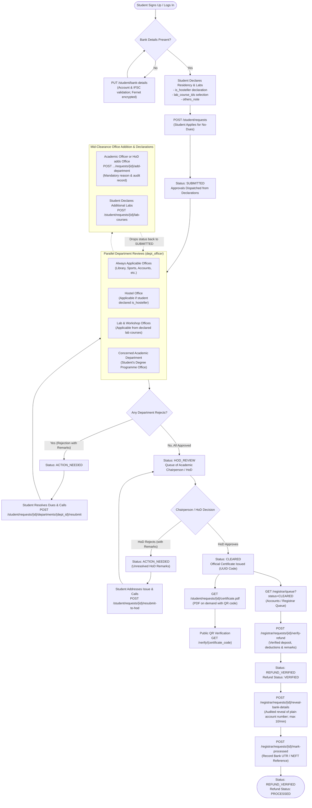

# SVSU No-Dues Clearance System — Developer API Guide & System Specification

Welcome! This guide is the complete contract for frontend engineers and backend operators. Everything is managed through the FastAPI REST API and documented interactively via Swagger UI.

---

## 1. Quick Start: Running the Backend

Run these commands inside the `backend/` folder:

```bash
# 1. Start the PostgreSQL container (if not already running)
docker compose up -d

# 2. Apply database migrations
uv run alembic upgrade head

# 3. Seed demo university departments, courses, officers, and test students
uv run python -m scripts.seed_synthetic

# 4. Start the FastAPI development server with hot reload
uv run fastapi dev src/backend/app/main.py --host 0.0.0.0 --port 8000
```

### API & Docs URLs
- **Interactive Swagger UI**: [http://localhost:8000/docs](http://localhost:8000/docs)
- **OpenAPI JSON Schema**: [http://localhost:8000/openapi.json](http://localhost:8000/openapi.json)
- **Interactive ReDoc**: [http://localhost:8000/redoc](http://localhost:8000/redoc)

---

## 2. Who Does What: Roles & Responsibility Matrix

To eliminate administrative bottlenecks, responsibility is strictly split across distinct university actors:

| Role / Actor | Core Duties & Authority | Key Endpoints | Data Visibility Limits |
|---|---|---|---|
| **Student** (`student`) | 1. Provides/updates refund bank details.<br/>2. Declares hostel residency, lab subjects, and special notes when applying.<br/>3. Can declare additional lab subjects mid-clearance.<br/>4. Resubmits to rejected departments or HoD.<br/>5. Downloads official signed PDF certificate once cleared.<br/>6. Can cancel request while all approvals are still PENDING. | `POST /student/requests`<br/>`GET /student/requests/current`<br/>`PUT /student/bank-details`<br/>`POST /student/requests/{id}/lab-courses`<br/>`POST /student/requests/{id}/departments/{d_id}/resubmit`<br/>`POST /student/requests/{id}/resubmit-to-hod`<br/>`POST /student/requests/{id}/cancel`<br/>`GET /student/requests/{id}/certificate.pdf` | Sees only own request. Bank account is strictly masked (`********1234`). Never sees roster provenance or administrative audit internals. |
| **Academic Department Officer** (`dept_officer` academic) | 1. Reviews and decides clearance for students in their academic faculty.<br/>2. Maintains student roster for **own** department programmes.<br/>3. Maintains lab catalog for **own** department programmes.<br/>4. Can add dealing offices to active clearance requests with mandatory justification.<br/>5. Can cancel clearance request of own students with mandatory reason.<br/>*Note: One officer can be a member of multiple departments (e.g. academic + service, or multiple labs). Approvals stay attached to departments, not persons.* | `GET /department/queue`<br/>`POST /department/approvals/{id}/decision`<br/>`GET /department/requests/{id}`<br/>`POST /department/requests/{id}/add-department`<br/>`POST /department/requests/{id}/cancel`<br/>`GET /department/roster*`<br/>`POST /department/roster*`<br/>`GET /department/lab-courses*`<br/>`POST /department/lab-courses*` | Restricted strictly to programmes and students belonging to their academic department. Bank details are never exposed. |
| **Service Department Officer** (`dept_officer` service) | 1. Reviews clearances for their service domain (e.g. Library, Sports, Hostel, Lab-1).<br/>2. Approves or rejects (with mandatory remarks).<br/>3. Lab officers see student declared subjects matching their lab.<br/>*Note: Multi-office officers see pending items across all assigned offices with office counts, and can filter per office.* | `GET /department/queue`<br/>`POST /department/approvals/{id}/decision` | Strictly barred (403 Forbidden) from managing rosters or creating lab courses. No student bank details. |
| **Chairperson / HoD** (`hod`) | 1. Reviews all departmental sign-offs once all approvals are granted.<br/>2. Grants final clearance (issuing official Certificate) or rejects back with remarks.<br/>3. Can add dealing offices with mandatory justification.<br/>*Note: An HoD can head multiple academic departments simultaneously.* | `GET /hod/queue`<br/>`GET /hod/requests/{id}`<br/>`POST /hod/requests/{id}/decision`<br/>`POST /hod/requests/{id}/add-department` | Restricted strictly to students enrolled in their academic department programmes. No bank details. |
| **Registrar & Accounts** (`registrar_accounts`) | 1. Reviews cleared requests awaiting caution money refund.<br/>2. Verifies official deposit amount against university ledger, applies deductions, and approves.<br/>3. Initiates bank disbursement and records transaction payment reference.<br/>4. Audited reveal of plain bank details (rate limited). | `GET /registrar/queue`<br/>`GET /registrar/requests/{id}`<br/>`POST /registrar/requests/{id}/verify-refund`<br/>`POST /registrar/requests/{id}/mark-processed`<br/>`POST /registrar/requests/{id}/reveal-bank-details` | Sees full roster provenance (creator/source). Bank details are masked on queue and detail views; unmasked account number is revealed strictly via the audited reveal endpoint. |
| **System Administrator** (`admin`) | 1. Provisions office accounts (dealing officers, HoDs, registrar).<br/>2. Monitors department staffing health (`missing_officer`, `missing_hod`).<br/>3. Global fallback power over rosters, catalogs, and password resets.<br/>4. Can cancel active clearance requests with mandatory reason. | `GET /admin/offices`<br/>`POST /admin/users/bulk-upload`<br/>`GET /admin/users`<br/>`POST /admin/users`<br/>`POST /admin/users/{id}/reset-password`<br/>`PATCH /admin/users/{id}/active`<br/>`POST /admin/requests/{id}/cancel`<br/>`POST /admin/roster/upload` (fallback) | Global administrative oversight. Never receives password hashes. Cannot reveal student bank accounts. |

---

## 3. Complete End-to-End Clearance Workflow



---

## 4. Bank Data Protection & `BANK_DATA_KEY` Setup

Student bank accounts are encrypted at rest to safeguard financial privacy.

### Encryption Architecture
- **Algorithm**: Fernet symmetric authenticated encryption (`cryptography` library), AES-128-CBC + HMAC-SHA256.
- **Storage**: `bank_details.account_number` is stored as an encrypted URL-safe string token (100–120 characters in `VARCHAR(255)`).
- **Masking Everywhere**: All read endpoints (`GET /student/bank-details`, `GET /student/requests/current`, `GET /registrar/queue`, `GET /registrar/requests/{id}`) return masked values (`********1234`).
- **Full Account Reveal**: Only `POST /registrar/requests/{id}/reveal-bank-details` returns the plain account number, protected by:
  1. Role restriction: `registrar_accounts` only.
  2. Request lifecycle guard: `CLEARED` or `REFUND_VERIFIED` requests only.
  3. Sliding-window rate limit: max 10 requests per minute per user (returns 429 Too Many Requests if exceeded).
  4. Immutable audit logging: records timestamp, user ID, request ID. **The plaintext account number is never logged or exposed in audit trails.**

### Configuration
Generate a 32-byte URL-safe base64 key in Python:
```bash
python -c "from cryptography.fernet import Fernet; print(Fernet.generate_key().decode())"
```
Place in `backend/.env`:
```env
BANK_DATA_KEY=9VgS5iI8WKkmZC3Irsvriq4CkX1OLKU4eHXp0DiwynA=
```
> [!IMPORTANT]
> The backend refuses to start up if `BANK_DATA_KEY` is missing or invalid in any environment except `APP_ENV=test` (in testing, a fallback key is automatically used). Never commit secret production keys to version control.

---

## 5. System Health & Production Hardening Guardrails

The system enforces automated startup validation and proactive operational health monitoring.

### A. Health Check Endpoint (`GET /health`)
- **Path**: `GET /health`
- **Access**: Public / Load Balancers / Monitoring
- **Function**: Executes an active `SELECT 1` probe against PostgreSQL.
- **Responses**:
  - `200 OK`: `{"status": "ok", "database": "connected"}`
  - `503 Service Unavailable`: `{"status": "unhealthy", "database": "disconnected"}` when database connectivity fails.

### B. Production Guardrails (`APP_ENV=production`)
When deployed with `APP_ENV=production`, the application refuses to start and raises a `RuntimeError` immediately if any of these security invariants are violated:
1. `JWT_SECRET` must be a high-entropy secret at least 32 characters long.
2. `DEV_RETURN_OTP` must be `False` (OTP codes must never be leaked in API responses).
3. `MAIL_CONSOLE_ONLY` must be `False` (production must route emails via configured SMTP).
4. `BANK_DATA_KEY` must be configured with a valid 32-byte Fernet key.


---

## 6. CSV Upload Specifications

### A. Academic Department Student Roster CSV
- **Endpoint**: `POST /department/roster/upload` (Academic officers) or `POST /admin/roster/upload` (Admin fallback).
- **Header row**: `registration_number,name,email,mobile,address,programme,is_hosteller,security_deposit_amount`

| Column | Type | Constraints / Description | Sample Value |
|---|---|---|---|
| `registration_number` | String | Unique student roll / registration code | `2026CS901` |
| `name` | String | Student full name | `Arjun Mehta` |
| `email` | String | Student university email (institutional domain) | `arjun.mehta@example.edu` |
| `mobile` | String | Contact mobile number | `9876543210` |
| `address` | String | Home or correspondence address | `Campus Hostels, SVSU Palwal` |
| `programme` | String / Int | Programme name or ID (must belong to officer's academic department) | `Bachelor of Technology (B.Tech.) Computer Engineering` |
| `is_hosteller` | Boolean | `true`/`false`, `1`/`0`, `yes`/`no` (roster baseline) | `true` |
| `security_deposit_amount` | Decimal | Non-negative caution deposit amount | `5000.00` |

### B. Lab & Workshop Catalog CSV
- **Endpoint**: `POST /department/lab-courses/upload`
- **Header row**: `code,name,lab_office,specialization`

| Column | Type | Constraints / Description | Sample Value |
|---|---|---|---|
| `code` | String | Unique subject code | `CSE-L101` |
| `name` | String | Subject / laboratory title | `Data Structures & Algorithms Lab` |
| `lab_office` | String / Int | Service department name or ID (must be `ASSIGNED_ONLY`, e.g. `Lab-1`, `Lab-2`) | `Lab-1` |
| `specialization`| String | Optional branch specialization or track | `Artificial Intelligence` |

### C. Staff Users Bulk Provisioning CSV
- **Endpoint**: `POST /admin/users/bulk-upload` (Admin only; supports optional query parameter `?google_only=true`)
- **Header row**: `email,full_name,role,department` (optional column: `google_only`)

| Column | Type | Constraints / Description | Sample Value |
|---|---|---|---|
| `email` | String | Staff email | `officer.csit@example.edu` |
| `full_name` | String | Staff full name | `Dr. Rajesh Kumar` |
| `role` | String | `dept_officer`, `hod`, `registrar_accounts`, `admin` | `dept_officer` |
| `department` | String / Int | Required for `dept_officer` and `hod` | `Skill Department of CS/IT` |
| `google_only` | Boolean | Optional (`true`/`false`). When true, creates passwordless account for Google SSO. | `true` |

---

## 7. Complete Endpoint Inventory

### System Monitoring & Health
| Method | Path | Allowed Roles | Summary / Purpose |
| :--- | :--- | :--- | :--- |
| `GET` | `/health` | Public / Monitoring | Live database connectivity probe (`SELECT 1`). Returns 200 OK or 503 Service Unavailable. |

### Authentication (`/auth`)
| Method | Path | Allowed Roles | Summary / Purpose |
| :--- | :--- | :--- | :--- |
| `GET` | `/auth/config` | Public | Public authentication metadata (`google_enabled`, `google_client_id`, `allowed_domain_hint`, `otp_signup_enabled`). |
| `POST` | `/auth/google` | Public | Single Sign-On via Google OAuth2 ID token credential. Checks domain, roster enrollment for students on first login, and creates student user or binds existing user. Rate limited: 20 per IP / 15m, 10 failed per email / 15m. |
| `POST` | `/auth/signup/request-otp` | Public | Initiates student self-registration via OTP (gated by `AUTH_OTP_SIGNUP_ENABLED`; rate limited: 3/email/hr, 3/reg#/hr, 5/IP/hr; returns generic message to prevent account enumeration). |
| `POST` | `/auth/signup/verify` | Public | Verifies OTP and activates student account (gated by `AUTH_OTP_SIGNUP_ENABLED`; min 10 chars password). |
| `POST` | `/auth/login` | Public | User authentication returning Bearer JWT token (rate limited: 5 failed attempts per 15 min per email & IP; returns `must_change_password`; blocked for students when `AUTH_PASSWORD_LOGIN_FOR_STUDENTS=false` or for users with NULL password hash). |
| `GET` | `/auth/me` | Authenticated | Returns profile of current authenticated user (includes primary `department_id` and full `departments: list[DepartmentBrief] [{id, name, kind}]` list across all assigned offices; accessible even if password change required). |
| `POST` | `/auth/change-password` | Authenticated | Changes user password (min 10 chars, clears `must_change_password`; returns 400 for passwordless Google users). |

### Student Workspace (`/student`)
| Method | Path | Allowed Roles | Summary / Purpose |
| :--- | :--- | :--- | :--- |
| `GET` | `/student/bank-details` | `student` | Returns masked refund bank details (`********1234`). |
| `PUT` | `/student/bank-details` | `student` | Updates refund bank details with authenticated Fernet encryption at rest. |
| `POST` | `/student/requests` | `student` | Submits clearance application with declarations (`is_hosteller`, `lab_course_ids`, `others_note`, and optional `other_department_ids` / `other_office_ids`). Validates other offices are `ASSIGNED_ONLY`, unlinked to lab subjects, and staffed. |
| `GET` | `/student/requests/current` | `student` | Returns clearance checklist and current progress, including refund breakdown (`refund_status`, `deposit_amount`, `deductions`, `final_amount`, and `payment_reference` populated strictly when status is `PROCESSED`). |
| `POST` | `/student/requests/{id}/cancel` | `student` | Cancels clearance request (allowed strictly while all approvals remain `PENDING`). |
| `POST` | `/student/requests/{id}/lab-courses` | `student` | Declares additional lab subjects mid-clearance (resets status back to `SUBMITTED` if currently in `HOD_REVIEW`). |
| `POST` | `/student/requests/{id}/departments` | `student` | Adds dealing department to active clearance request. |
| `GET` | `/student/lab-catalog` | `student` | Scoped lab catalog (own department + open electives). |
| `POST` | `/student/requests/{id}/departments/{d_id}/resubmit` | `student` | Resubmits review line after resolving dues. |
| `POST` | `/student/requests/{id}/resubmit-to-hod` | `student` | Resubmits request to HoD after addressing remarks. |
| `GET` | `/student/requests/{id}/certificate.pdf` | `student` | Generates and downloads official clearance certificate PDF. |

### Department Officers (`/department`)
| Method | Path | Allowed Roles | Summary / Purpose |
| :--- | :--- | :--- | :--- |
| `GET` | `/department/queue` | `dept_officer` | Paginated queue of clearance tasks across all offices assigned to officer (automatically excludes `CANCELLED` requests). Supports optional query filter `?department_id=X` (returns 404 if not assigned to officer). Response includes `office_counts: list[OfficePendingCount]` (`department_id`, `department_name`, `pending`) across all assigned offices. Queue items include `department_id`, `department_name`, `declared_is_hosteller` (bool, scoped only to Hostel office, else null) and `others_note` (scoped only to offices on request not linked to any declared lab course, else null). |
| `POST` | `/department/approvals/{id}/decision` | `dept_officer` | Submits approval or rejection decision for an approval belonging to any of officer's assigned departments. |
| `POST` | `/department/requests/{id}/add-department` | `dept_officer` (acad) | Adds dealing office with mandatory justification. |
| `POST` | `/department/requests/{id}/cancel` | `dept_officer` (acad) | Cancels clearance request of own student with mandatory reason (forbidden if `CLEARED` or `REFUND_VERIFIED`). |
| `GET` | `/department/requests/{id}` | `dept_officer` (any assigned) | Clearance dossier for a request. If officer is assigned to student's academic department, returns full dossier (roster, approvals snapshot, audit log, can_add_departments). If officer is assigned strictly to service offices on the request, returns limited dossier scoped across all their assigned offices on the request (student info, programme, academic dept, approvals for their offices, hostel declaration if hostel office, matching declared lab subjects, and others_note if applicable). Unrelated officers receive 404. |
| `GET` | `/department/roster/template.csv` | `dept_officer` (acad) | Downloads roster CSV template. |
| `POST` | `/department/roster/upload` | `dept_officer` (acad) | Uploads student roster for officer's programmes. |
| `POST` | `/department/roster` | `dept_officer` (acad) | Adds single student to roster. |
| `GET` | `/department/roster` | `dept_officer` (acad) | Lists roster records scoped to officer's department. |
| `PATCH` | `/department/roster/{id}` | `dept_officer` (acad) | Updates roster student record. |
| `GET` | `/department/lab-courses/template.csv`| `dept_officer` (acad) | Downloads lab courses CSV template. |
| `GET` | `/department/lab-courses` | `dept_officer` (acad) | Lists lab courses scoped to officer's department. |
| `POST` | `/department/lab-courses` | `dept_officer` (acad) | Creates lab course mapped to service lab. |
| `POST` | `/department/lab-courses/upload` | `dept_officer` (acad) | Bulk uploads lab courses from CSV. |
| `PATCH` | `/department/lab-courses/{id}` | `dept_officer` (acad) | Updates lab course metadata. |

### Chairperson / HoD (`/hod`)
| Method | Path | Allowed Roles | Summary / Purpose |
| :--- | :--- | :--- | :--- |
| `GET` | `/hod/queue` | `hod` | Queue of clearance applications in `HOD_REVIEW` across all academic departments headed by the HoD. |
| `GET` | `/hod/requests/{id}` | `hod` | Detailed clearance dossier with declarations and can_add_departments (accessible if student belongs to any of HoD's academic departments). |
| `POST` | `/hod/requests/{id}/decision` | `hod` | Grants final approval (issues certificate) or rejects with remarks. |
| `POST` | `/hod/requests/{id}/add-department` | `hod` | Chairperson adds dealing office with mandatory justification. |

### Registrar / Accounts (`/registrar`)
| Method | Path | Allowed Roles | Summary / Purpose |
| :--- | :--- | :--- | :--- |
| `GET` | `/registrar/queue` | `registrar_accounts` | Queue of requests in `CLEARED` or `REFUND_VERIFIED`. |
| `GET` | `/registrar/requests/{id}` | `registrar_accounts` | Request details with roster provenance and masked account. |
| `POST` | `/registrar/requests/{id}/verify-refund` | `registrar_accounts` | Sets verified deposit amount, deductions, and remarks. |
| `POST` | `/registrar/requests/{id}/mark-processed` | `registrar_accounts` | Records disbursement transaction payment reference in database. |
| `POST` | `/registrar/requests/{id}/reveal-bank-details` | `registrar_accounts` | Audited reveal of full plain bank account number (max 10/min). |

### Public Verification (`/verify`)
| Method | Path | Allowed Roles | Summary / Purpose |
| :--- | :--- | :--- | :--- |
| `GET` | `/verify/{certificate_code}` | Public | Public QR verification returning certificate validity without privacy leaks. |

### University Departments (`/departments` & `/programmes`)
| Method | Path | Allowed Roles | Summary / Purpose |
| :--- | :--- | :--- | :--- |
| `GET` | `/departments` | Authenticated | Lists all active university departments with computed `category` and human-friendly `label`. Filter `?all=true` (admin only) includes inactive. |
| `GET` | `/departments/assigned-only` | Authenticated | Lists active `ADDITIONAL_FACILITY` departments. |
| `GET` | `/departments/additional-facilities` | Authenticated | Alias of `/departments/assigned-only`. |
| `GET` | `/programmes` | Authenticated | Lists active degree programmes with `academic_department_name` and `faculty_name`. |

### Department Officers (`/department`)
| Method | Path | Allowed Roles | Summary / Purpose |
| :--- | :--- | :--- | :--- |
| `GET` | `/department/queue` | `dept_officer` | Paginated queue of clearance tasks across all offices assigned to officer (automatically excludes `CANCELLED` requests). Supports optional query filter `?department_id=X` (returns 404 if not assigned to officer). Response includes `office_counts: list[OfficePendingCount]` (`department_id`, `department_name`, `pending`) across all assigned offices. Queue items include `department_id`, `department_name`, `declared_is_hosteller` (bool, scoped only to Hostel office, else null) and `others_note` (scoped strictly to additional-facility offices on request, else null). |
| `POST` | `/department/approvals/{id}/decision` | `dept_officer` | Submits approval or rejection decision for an approval belonging to any of officer's assigned departments. |
| `POST` | `/department/requests/{id}/add-department` | `dept_officer` (acad) | Adds dealing office with mandatory justification. |
| `POST` | `/department/requests/{id}/cancel` | `dept_officer` (acad) | Cancels clearance request of own student with mandatory reason (forbidden if `CLEARED` or `REFUND_VERIFIED`). |
| `GET` | `/department/requests/{id}` | `dept_officer` (any assigned) | Clearance dossier for a request. If officer is assigned to student's academic department, returns full dossier (roster, approvals snapshot, audit log, can_add_departments). If officer is assigned strictly to service offices on the request, returns limited dossier scoped across all their assigned offices on the request. |
| `GET` | `/department/roster/template.csv` | `dept_officer` (acad) | Downloads roster CSV template. |
| `POST` | `/department/roster/upload` | `dept_officer` (acad) | Uploads student roster for officer's programmes. |
| `POST` | `/department/roster` | `dept_officer` (acad) | Adds single student to roster. |
| `GET` | `/department/roster` | `dept_officer` (acad) | Lists roster records scoped to officer's department. |
| `PATCH` | `/department/roster/{id}` | `dept_officer` (acad) | Updates roster student record (including programme_id when student has no open clearance request). |
| `GET` | `/department/lab-courses/template.csv`| `dept_officer` (acad) | Downloads lab courses CSV template. |
| `GET` | `/department/lab-courses` | `dept_officer` (acad) | Lists lab courses scoped to officer's department. |
| `POST` | `/department/lab-courses` | `dept_officer` (acad) | Creates lab course mapped to an active `LAB_WORKSHOP` office. |
| `POST` | `/department/lab-courses/upload` | `dept_officer` (acad) | Bulk uploads lab courses from CSV. Supports query params `?dry_run=true` and `?create_missing_offices=true`. Reports `offices_to_create`, `offices_without_officers`, and detects office reassignments. |
| `PATCH` | `/department/lab-courses/{id}` | `dept_officer` (acad) | Updates lab course metadata (`code`, `name`, `lab_department_id`, `specialization`, `is_active`). |
| `GET` | `/department/lab-workshops` | `dept_officer` | Lists all active lab / workshop offices, with `editable: bool` flag indicating if current officer created them. |
| `POST` | `/department/lab-workshops` | `dept_officer` | Creates a new `LAB_WORKSHOP` office. Automatically records `created_by_user_id` and assigns officer to the office. |
| `PATCH` | `/department/lab-workshops/{id}` | `dept_officer` | Updates an officer-created `LAB_WORKSHOP` office name (forbidden if open clearance requests are attached). |

### System Administration (`/admin`)
| Method | Path | Allowed Roles | Summary / Purpose |
| :--- | :--- | :--- | :--- |
| `GET` | `/admin/offices` | `admin` | Department staffing dashboard with `category`, `label`, `is_active`, and missing officer/HoD flags. |
| `GET` | `/admin/departments` | `admin` | Department directory with category counts, active requests, active students, and linked lab courses metrics. |
| `POST` | `/admin/departments` | `admin` | Creates department (`name`, `category`, `faculty_id`). |
| `PATCH` | `/admin/departments/{id}` | `admin` | Updates department name, category, or active status (guarded against open clearance requests; deactivating core office requires `confirm=true`). |
| `DELETE` | `/admin/departments/{id}` | `admin` | Deletes unreferenced department (returns 409 "Deactivate it instead" if referenced by approvals, roster, lab courses, or staff). |
| `POST` | `/admin/departments/bulk-category` | `admin` | Bulk reassigns department categories (`department_ids: list[int]`, `target_category`). Guarded against open requests. |
| `GET` | `/admin/faculties` | `admin` | Lists faculties with department counts. |
| `POST` | `/admin/faculties` | `admin` | Creates faculty (`name`, `short_code`). |
| `PATCH` | `/admin/faculties/{id}` | `admin` | Updates faculty (`name`, `short_code`). |
| `GET` | `/admin/academic-departments` | `admin` | Lists academic departments with programme counts. |
| `POST` | `/admin/academic-departments` | `admin` | Creates academic department under a faculty. |
| `PATCH` | `/admin/academic-departments/{id}` | `admin` | Updates academic department (`name`, `faculty_id`, `is_active`). Guarded against active students / open requests. |
| `GET` | `/admin/programmes` | `admin` | Lists degree programmes. |
| `POST` | `/admin/programmes` | `admin` | Creates programme (`name`, `academic_department_id`). |
| `PATCH` | `/admin/programmes/{id}` | `admin` | Updates programme (`name`, `academic_department_id`, `is_active`). Guarded against active students / open requests. |
| `POST` | `/admin/users/bulk-upload` | `admin` | Bulk provisions staff accounts from CSV. Supports pipe-separated `departments` column (e.g. `"Sports | Library"`). |
| `GET` | `/admin/users` | `admin` | Paginated staff accounts directory. Items include `departments: list[DepartmentBrief]`. Filter `?department_id=X` finds users assigned via primary or multi-membership. |
| `POST` | `/admin/users` | `admin` | Provisions single staff account with `department_ids: list[int]`. Enforces $\ge 1$ department for officers and academic-only for HoD. |
| `GET` | `/admin/users/{id}` | `admin` | Retrieves full user details including primary department and `departments` membership list. |
| `PATCH` | `/admin/users/{id}` | `admin` | Updates staff name or email. Requires `unlink_google=true` if email changes on a Google-linked account. |
| `POST` | `/admin/users/{id}/departments` | `admin` | Adds department membership to user (`{"department_id": int}`). Enforces academic-only for HoD accounts. Audited. |
| `DELETE` | `/admin/users/{id}/departments/{department_id}` | `admin` | Removes department membership from user. Refuses removing last department with 409 (`"Deactivate the user instead"`). Promotes remaining department to primary if primary is removed. Audited. |
| `POST` | `/admin/users/{id}/reset-password` | `admin` | Generates new one-time temporary password (sets `must_change_password=True`). |
| `PATCH` | `/admin/users/{id}/active` | `admin` | Toggles account active status. |
| `POST` | `/admin/requests/{id}/cancel` | `admin` | Cancels clearance request with mandatory reason (forbidden if `CLEARED` or `REFUND_VERIFIED`). |
| `POST` | `/admin/roster/upload` | `admin` | Global roster CSV upload fallback. |
| `GET` | `/admin/roster` | `admin` | Global roster search fallback. |
| `PATCH` | `/admin/roster/{id}` | `admin` | Global roster row edit fallback. |
| `PUT` | `/admin/roster/{id}/assigned-departments` | `admin` | Updates assigned departments for a student. |
| `GET` | `/admin/lab-courses` | `admin` | Global lab catalog fallback. |
| `POST` | `/admin/lab-courses` | `admin` | Global lab course creation fallback. |
| `POST` | `/admin/lab-courses/upload` | `admin` | Global lab courses CSV upload with `dry_run` and `create_missing_offices`. |
| `PATCH` | `/admin/lab-courses/{id}` | `admin` | Global lab course update fallback. |

---

## 7. Seeded Demo Accounts

All seeded demo accounts are generated via `backend/scripts/seed_synthetic.py`. Demo accounts exist **only for staff**; zero demo students are seeded for pilot safety. Default passwords are never published in documentation; in development environments, they are derived from the `SEED_DEFAULT_PASSWORD` environment variable in `backend/.env`.

Staff accounts are provisioned under the domain specified by `SEED_STAFF_EMAIL_DOMAIN` (default: `svsu.ac.in`):

| Role | Email Address | Display Name / Department |
|---|---|---|
| **Admin** | `admin@svsu.ac.in` | System Administrator (Demo) |
| **Registrar / Accounts** | `registrar.accounts@svsu.ac.in` | Accounts Officer (Demo) / R&S Branch |
| **Chairperson (HoD) CS/IT** | `hod.csit@svsu.ac.in` | Chairperson Skill Department of CS/IT (Demo) |
| **Library Officer** | `library.officer@svsu.ac.in` | Library Officer (Demo) / Central Library |
| **Hostel Officer** | `hostel.officer@svsu.ac.in` | Hostel (Boys/Girls) Officer (Demo) |
| **Sports Officer** | `sports.officer@svsu.ac.in` | Sports Officer (Demo) / Sports Section |
| **Academic Officer (CS/IT)** | `officer.csit@svsu.ac.in` | Skill Department of CS/IT Officer (Demo) |
| **Accounts Officer** | `accounts.officer@svsu.ac.in` | Account Section Officer (Demo) |
| **Computer Lab Officer** | `complab.officer@svsu.ac.in` | Computer Lab/Centre Officer (Demo) |
| **Transportation Officer** | `transport.officer@svsu.ac.in` | General/Transportation Branch Officer (Demo) |
| **Dean Student Welfare** | `dsw.officer@svsu.ac.in` | Dean Student Welfare Officer (Demo) |
| **N.S.S. Officer** | `nss.officer@svsu.ac.in` | N.S.S. Officer (Demo) |
| **IIC Officer** | `iic.officer@svsu.ac.in` | IIC Officer (Demo) |

> **Pilot Security Reminder**: Replace demo staff with real staff accounts before enabling real email delivery or letting real students apply. Zero demo students are seeded into the system; student roster entries must be uploaded by academic departments or administrators.
